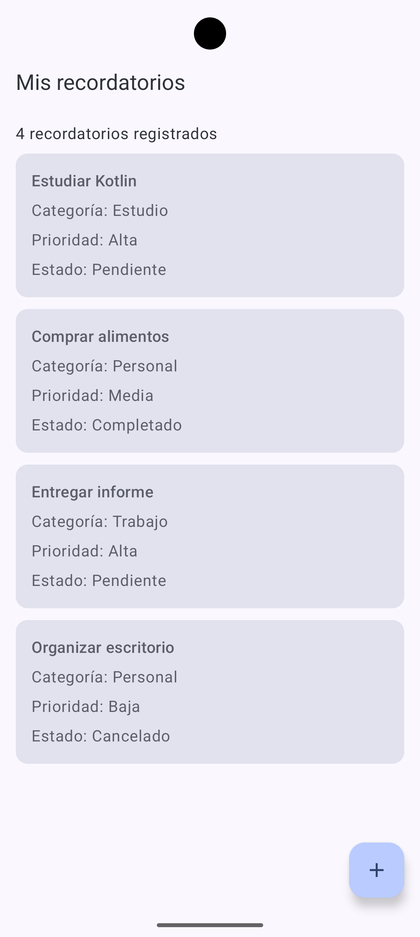
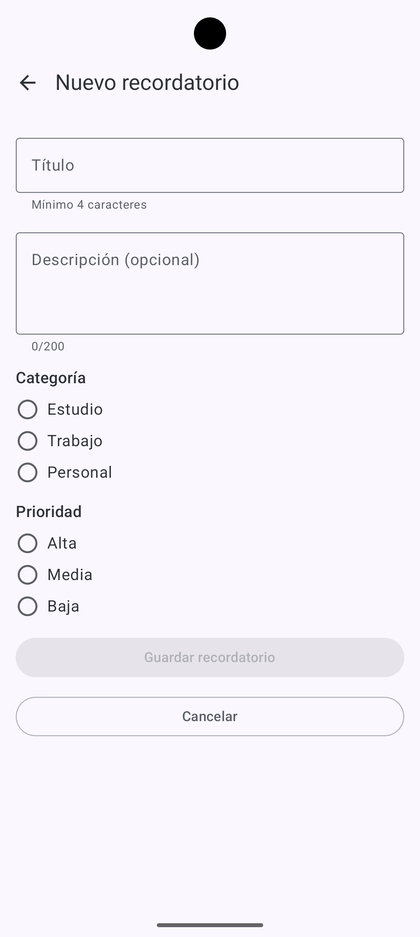
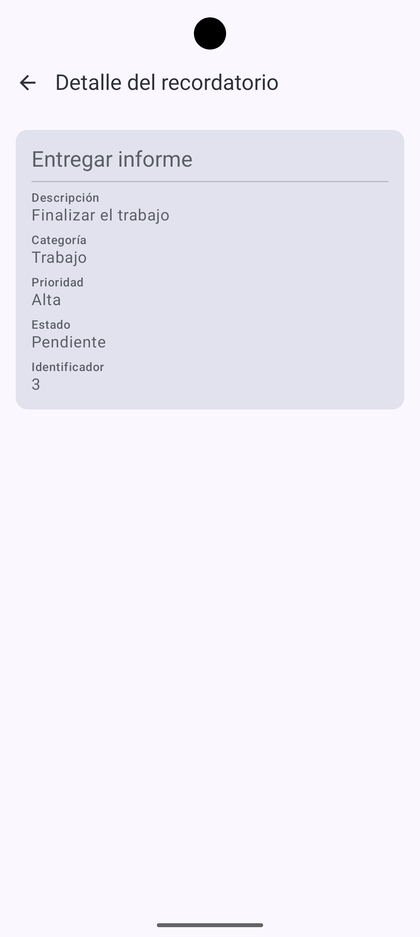

# RecordatoriosApp

> App Android desarrollada con Kotlin y Jetpack Compose para gestionar recordatorios. La tercera entrega persiste los datos con Room y DataStore, organiza la capa de datos con un repositorio local-first y sincroniza los cambios con un servicio remoto mediante Retrofit, OkHttp y WorkManager, de modo que la app sigue funcionando sin conexión.


## Acerca del proyecto

Proyecto de **Programación Mobile**: Teclab, Tecnicatura Superior en Programación (Bimestre 2B). La app se desarrolla de forma incremental a lo largo de los cuatro módulos de la materia.

| Entrega | Contenido |
|---|---|
| **Actividad 1** | Configuración del proyecto, modelo de dominio con data classes y sealed classes, datos simulados y una primera pantalla de listado. |
| **Actividad 2** | Pantallas de listado, creación y detalle; componentes reutilizables; formulario validado; ViewModel + UiState + StateFlow; navegación con Navigation Compose. |
| **Actividad 3** (actual) | Preferencias con DataStore; persistencia con Room; crear, editar, completar y eliminar; repositorio local-first; servicio remoto con Retrofit y OkHttp; sincronización en segundo plano con WorkManager; funcionamiento offline. |

La ubicación y los avisos llegan en el módulo siguiente.

<p align="center">
  
  
  
</p>

## Stack tecnológico

| Capa | Detalle |
|---|---|
| **Lenguaje** | Kotlin 2.2 (KSP para el compilador de Room) |
| **UI** | Jetpack Compose + Material 3 (Compose BOM 2026.02.01), Navigation Compose 2.10 |
| **Estado** | ViewModel, StateFlow, Coroutines, `collectAsStateWithLifecycle` |
| **Persistencia** | Room 2.8 (registros) · Preferences DataStore 1.3 (configuración) |
| **Red** | Retrofit 3 + Gson · OkHttp 5 |
| **Segundo plano** | WorkManager 2.11 |
| **SDK** | `minSdk` 26 · `targetSdk` / `compileSdk` 37 |

## Arquitectura de la capa de datos

La interfaz nunca lee el servicio remoto: **Room es la fuente de verdad**. El servicio complementa los datos locales mediante una sincronización controlada.

```
Compose ──evento──▶ ViewModel ──▶ RecordatorioRepository (RepositorioRoom) ◀── DataStore
   ▲                                   │ 1. escribe en Room (pendiente)            (filtro y orden)
   │                                   │ 2. programa la sincronización
   │                                   ▼
   └──── StateFlow<UiState> ◀──────── Room (RecordatorioDao, Flow)
                                       ▲            ▲
                     marcarSincronizado│            │ insertar / actualizar desde el servidor
                                       │            │ (DTO → Entity validado)
           WorkManager ──▶ SincronizacionWorker ──▶ SincronizadorRecordatorios ──▶ Retrofit / OkHttp
           (requiere red,     (trabajo único)         1. envía pendientes             (ResultadoApi)
            backoff exponencial)                      2. descarga GET /recordatorios
```

El repositorio coordina las tres fuentes: lee de Room, aplica las preferencias de DataStore (mostrar completados con una consulta filtrada del DAO y el orden elegido) y deja el servicio remoto en manos de la sincronización en segundo plano.

### Modelos por capa

| Capa | Modelo | Archivo |
|---|---|---|
| Servicio remoto | `RecordatorioDto` (contrato de la API, id remoto `String`) | `data/remote/RecordatorioDto.kt` |
| Base local | `RecordatorioEntity` (esquema de Room + campos de sincronización) | `data/local/RecordatorioEntity.kt` |
| Dominio / UI | `Recordatorio` (sealed classes para categoría, prioridad y estado) | `Recordatorio.kt` |

Todos los mapeos están en `data/mapper/RecordatorioMapper.kt`: `Recordatorio.toEntity()`, `RecordatorioEntity.toDomain()`, `RecordatorioEntity.toDto()` y `RecordatorioDto.toEntityOrNull()`. Esta última valida lo que llega del servidor: un registro sin id o sin título se descarta, y una categoría, prioridad o estado desconocidos toman el valor predeterminado. Los DTO nunca llegan a las funciones componibles.

### DataStore vs. Room

| | DataStore (`configuracion`) | Room (`recordatorios_database`) |
|---|---|---|
| Qué guarda | Configuración simple: tema oscuro, mostrar completados, orden del listado | Registros estructurados: los recordatorios |
| Forma | Pares clave/valor tipados | Tabla con consultas, filtros y migraciones |
| Valores por defecto | Tema claro, mostrar completados, orden por fecha. Una opción de orden desconocida vuelve a `FECHA`; un error de lectura (`IOException`) emite las preferencias por defecto | Los recordatorios de ejemplo se cargan una sola vez, al crear la base |

### Operaciones pendientes y deduplicación

- Crear, modificar o eliminar escribe primero en Room y marca el registro con `pendienteSincronizacion = true`. Eliminar es un borrado lógico (`eliminado = true`); cuando el servidor confirma la eliminación, el registro se borra de la base.
- Cada recordatorio muestra su estado de sincronización (**Pendiente**, **Sincronizado** o **Error**) y el listado muestra un aviso con la cantidad de cambios pendientes o rechazados, con un botón para sincronizar o reintentar.
- Cada registro recibe un **UUID** (`idRemoto`) al crearse, con índice único en Room. La sincronización envía `PUT /recordatorios/{uuid}` y, si el servidor no lo conoce (404), `POST`. Como el servidor usa el UUID como identificador, reenviar la misma operación actualiza el registro en lugar de duplicarlo.
- `versionLocal` aumenta con cada cambio. Al confirmar, `marcarSincronizado` solo limpia la marca si la versión no cambió durante el envío; si cambió, el registro queda pendiente y se vuelve a enviar.
- Al descargar, un registro remoto nuevo se inserta (con `IGNORE` sobre el índice único) y uno existente solo se actualiza si no tiene cambios locales sin enviar: en ese caso gana la versión local.
- Un `Mutex` impide dos sincronizaciones simultáneas, y `enqueueUniqueWork` evita que varios eventos encolen trabajos paralelos al recuperar la conexión.

### Tratamiento de errores de red

`ejecutarApi` (`data/remote/ApiExecutor.kt`) traduce cada respuesta a `ResultadoApi`. Ninguna pantalla interpreta códigos HTTP:

| Situación | Resultado | Acción de la sincronización |
|---|---|---|
| 2xx con cuerpo | `Exito` | Marca el registro como sincronizado |
| 4xx (excepto 408 y 429): solicitud inválida | `ErrorHttp` | Marca ese registro con **Error** y sigue con los demás. Se reintenta desde la interfaz |
| 5xx, 408, 429: error del servidor | `ErrorHttp` | El registro sigue pendiente; reintento con backoff exponencial |
| `SocketTimeoutException` | `TiempoAgotado` | Reintento |
| Otra `IOException` | `SinConexion` | Reintento |

En todos los casos los datos locales se conservan.

## Configuración

La URL base del servicio se lee de la propiedad de Gradle `RECORDATORIOS_API_BASE_URL` y se expone como `BuildConfig.API_BASE_URL`. El archivo [`gradle.properties.example`](gradle.properties.example) muestra el formato:

```properties
RECORDATORIOS_API_BASE_URL=https://example.com/
RECORDATORIOS_API_SIMULACION=NORMAL
```

Para apuntar a otro servicio, definí la propiedad en `~/.gradle/gradle.properties` o en el `gradle.properties` del proyecto. La URL debe terminar en `/`. El proyecto no incluye credenciales ni tokens.

**Servicio simulado:** en las compilaciones *debug*, `ApiSimuladaInterceptor` responde a `GET`, `POST`, `PUT` y `DELETE` sobre `/recordatorios` sin salir a internet, guardando los registros en memoria mientras la app está abierta. `RECORDATORIOS_API_SIMULACION` fuerza respuestas para probar cada error:

| Valor | Respuesta simulada |
|---|---|
| `NORMAL` | Respuestas correctas |
| `ERROR_SERVIDOR` | HTTP 500 |
| `SOLICITUD_INVALIDA` | HTTP 400 en escrituras |
| `TIMEOUT` | `SocketTimeoutException` |
| `SIN_CONEXION` | `UnknownHostException` |

Después de cambiar el valor hay que volver a compilar. Los logs aparecen en Logcat con las etiquetas `SYNC_API` (servicio) y `SYNC` (sincronización).

## Estructura del proyecto

```
app/src/main/java/com/oviedo/recordatorios/
├── MainActivity.kt                 Tema según preferencias + NavHost
├── RecordatoriosApplication.kt     Instancias únicas: base de datos, repositorios
├── Recordatorio.kt                 Modelo de dominio
├── data/
│   ├── RecordatorioRepository.kt   Contrato del repositorio
│   ├── RepositorioRoom.kt          Repositorio local-first
│   ├── SincronizadorRecordatorios.kt  Envío de pendientes al servicio
│   ├── local/                      Entity, DAO, base de datos, migraciones y datos iniciales
│   ├── mapper/                     Dominio ↔ Entity ↔ DTO
│   ├── preferences/                DataStore y modelo PreferenciasApp
│   ├── remote/                     DTO, API Retrofit, cliente, ResultadoApi, API simulada
│   └── sync/                       Worker y programador de WorkManager
└── ui/
    ├── components/                 Tarjeta, estados de pantalla, campos de formulario
    ├── navigation/                 Rutas: listado, crear, editar/{id}, detalle/{id}, preferencias
    ├── screens/                    Listado, Crear, Detalle, Preferencias
    ├── state/                      UiState de cada pantalla
    ├── theme/                      Tema Material 3 (claro / oscuro)
    └── viewmodel/                  ViewModels y factories
```

## Compilar y ejecutar

**Requisitos:** Android Studio (versión estable reciente) con Android SDK 37, y un emulador o un dispositivo con depuración USB. Desarrollado y probado en un emulador Pixel 9 Pro.

```bash
git clone https://github.com/aleoviedo071298/recordatorios-app.git
```

1. Abrir la carpeta en Android Studio y esperar a que Gradle sincronice.
2. (Opcional) Configurar `RECORDATORIOS_API_BASE_URL` como se indica arriba.
3. Ejecutar la configuración `app` en variante *debug*.

Desde la terminal:

```bash
./gradlew assembleDebug
```

```bash
./gradlew testDebugUnitTest
```

Las pruebas unitarias (`MapeosTest`) verifican los mapeos entre capas, el descarte de DTO inválidos y el valor predeterminado ante un orden desconocido.

**Probar el modo offline:** activar el modo avión, crear, modificar o eliminar recordatorios (se guardan en Room y quedan como *Pendiente de sincronizar*) y desactivarlo. WorkManager ejecuta la sincronización cuando vuelve la red y los recordatorios pasan a *Sincronizado*.

**Probar un valor inválido en DataStore:** en Preferencias (debug), el botón *Prueba: guardar un orden inválido* guarda un valor inexistente; la app lo ignora y ordena por fecha (Logcat, etiqueta `PREFERENCIAS`).

---

**Alejandro Oviedo** · [LinkedIn](https://www.linkedin.com/in/aleoviedo071298/) · [GitHub](https://github.com/aleoviedo071298)
