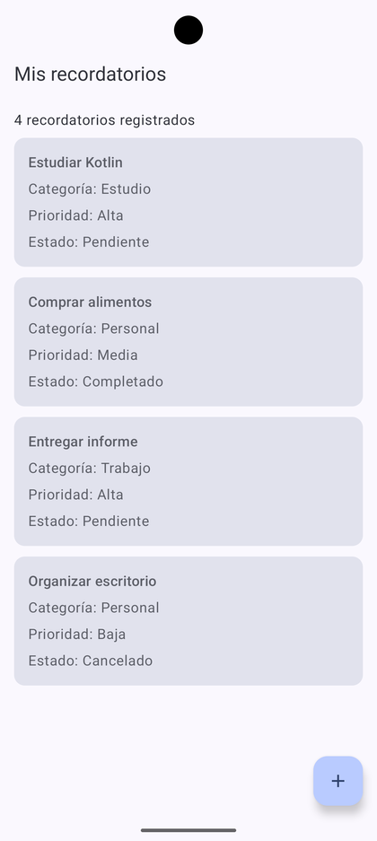
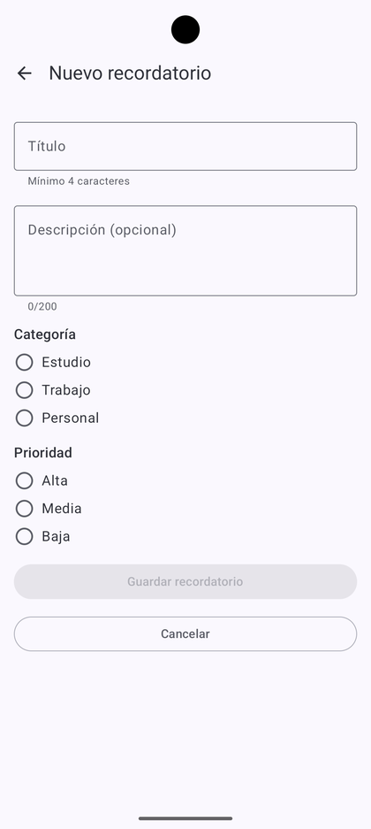
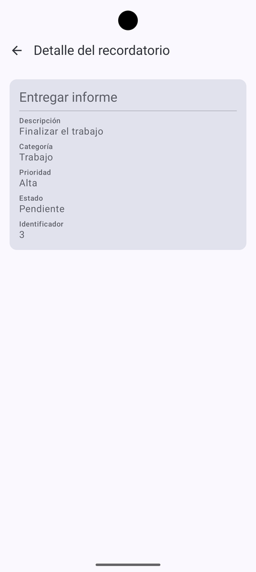
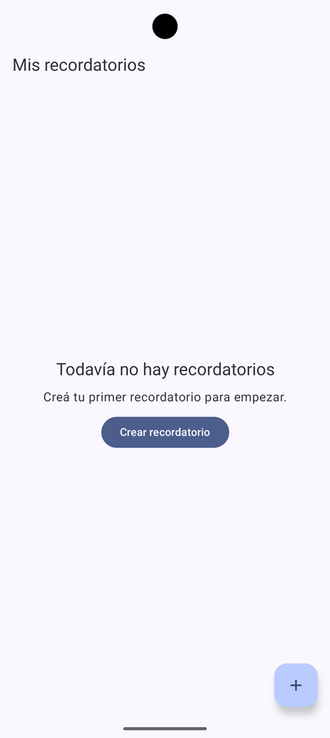
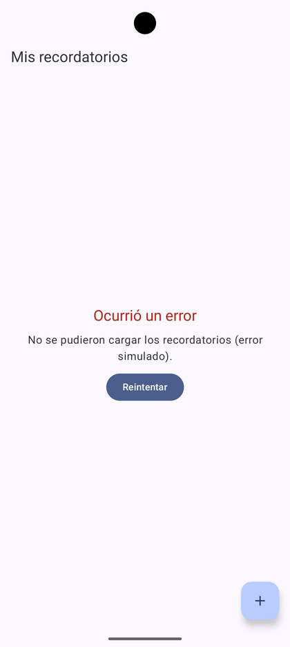

# RecordatoriosApp

> App Android desarrollada con Kotlin y Jetpack Compose para gestionar recordatorios. La segunda entrega suma listado, creación y detalle conectados con Navigation Compose, formularios validados y una arquitectura de presentación con ViewModel, UiState y StateFlow sobre un repositorio en memoria.


## Acerca del proyecto

Proyecto de **Programación Mobile**: Teclab, Tecnicatura Superior en Programación (Bimestre 2B). La app se desarrolla de forma incremental a lo largo de los cuatro módulos de la materia.

| Entrega | Contenido |
|---|---|
| **Actividad 1** | Configuración del proyecto, modelo de dominio con data classes y sealed classes, datos simulados y una primera pantalla de listado. |
| **Actividad 2** (actual) | Pantallas de listado, creación y detalle; componentes reutilizables; formulario validado; ViewModel + UiState + StateFlow; repositorio en memoria; navegación con Navigation Compose. |

La persistencia local, la sincronización remota, la ubicación y los avisos llegan en los módulos siguientes.

<p align="center">
  
  
  
</p>
<p align="center">
  
  
</p>

## Stack tecnológico

| Capa | Detalle |
|---|---|
| **Lenguaje** | Kotlin 2.2 |
| **UI** | Jetpack Compose + Material 3 (Compose BOM 2026.02.01) |
| **Navegación** | Navigation Compose 2.10 |
| **Estado** | ViewModel, StateFlow, Coroutines (`viewModelScope`), `collectAsStateWithLifecycle` |
| **Build** | Gradle (Kotlin DSL) con catálogo de versiones, AGP 9.4 |
| **SDK** | `minSdk` 26 · `targetSdk` / `compileSdk` 37 |

## Arquitectura

```
Pantalla (Compose) ──eventos──▶ ViewModel ──suspend──▶ RecordatorioRepository (interfaz)
       ▲                           │                           │
       └──── StateFlow<UiState> ◀──┘                 RepositorioEnMemoria
```

- **Repositorio**: `RecordatorioRepository` declara `obtenerRecordatorios`, `obtenerPorId` y `guardarRecordatorio`. `RepositorioEnMemoria` lo implementa. El ViewModel depende solo de la interfaz, así que la fuente de datos se puede reemplazar sin tocar las pantallas.
- **ViewModel**: recibe los eventos de la interfaz, aplica las validaciones y publica estados inmutables. Mantiene `MutableStateFlow` privados y expone `StateFlow` de solo lectura, que actualiza con `update { it.copy(...) }`. No guarda referencias a Activity ni a View.
- **UiState**:
  - `ListadoUiState`: `Cargando`, `Vacio`, `Contenido`, `Error` (sealed interface).
  - `DetalleUiState`: `Cargando`, `Contenido`, `Error` (sealed interface).
  - `FormularioUiState`: valores de los campos, mensajes de validación y `EstadoEnvio` (`Inactivo`, `Guardando`, `Exito`, `Error`).
- **Pantallas**: cada una tiene un punto de entrada con estado, que obtiene el ViewModel y observa el flujo, y un contenido sin estado que solo recibe datos y lambdas.

## Navegación

| Ruta | Pantalla | Argumentos | Acciones |
|---|---|---|---|
| `listado` (inicial) | `PantallaListado` | — | `onCrearRecordatorio`, `onRecordatorioClick(id)` |
| `crear` | `PantallaCrear` | — | `onGuardar`, `onCancelar` (`popBackStack()`) |
| `detalle/{id}` | `PantallaDetalle` | `id: Int` | `onVolver` (`popBackStack()`) |

El `NavController` se crea solo en `RecordatoriosNavHost`. Hacia el detalle se envía únicamente el identificador, nunca el objeto completo.

## Formulario y validaciones

- Título: al menos 4 caracteres después de `trim()`.
- Descripción: opcional, máximo 200 caracteres (con contador).
- Categoría y prioridad: obligatorias, elegidas entre las opciones de las sealed classes.
- **Guardar** se deshabilita si el formulario es inválido o si hay un guardado en curso.
- Los errores se comunican con `isError`, un texto "Error: …" y la propiedad semántica `error(...)`, no solo con color.

## Simulación de estados

`RecordatoriosApplication` crea el repositorio con tres parámetros que permiten comprobar todos los estados sin una base de datos:

```kotlin
RepositorioEnMemoria(
    simularListaVacia = false,    // listado vacío con acción "Crear recordatorio"
    simularErrorCarga = false,    // error de carga con botón "Reintentar"
    simularErrorGuardado = false  // error al guardar con "Reintentar guardado"
)
```

La carga (800 ms) y el guardado (1 s) simulan demoras con `delay` dentro de `viewModelScope`, sin bloquear la interfaz.

## Estructura del proyecto

```
app/src/main/java/com/oviedo/recordatorios/
├── MainActivity.kt                 Activity: tema + NavHost
├── RecordatoriosApplication.kt     Instancia única del repositorio
├── Recordatorio.kt                 Modelo de dominio y sealed classes
├── DatosSimulados.kt               Datos de prueba
├── data/
│   ├── RecordatorioRepository.kt   Interfaz del repositorio
│   └── RepositorioEnMemoria.kt     Implementación en memoria + simulación
└── ui/
    ├── components/                 TarjetaRecordatorio, EstadoPantalla, CamposFormulario
    ├── navigation/                 RecordatoriosNavHost y rutas
    ├── screens/                    PantallaListado, PantallaCrear, PantallaDetalle
    ├── state/                      ListadoUiState, DetalleUiState, FormularioUiState
    ├── theme/                      Tema Material 3
    └── viewmodel/                  RecordatoriosViewModel y su Factory
```

## Instalación

**Requisitos:** Android Studio (versión estable reciente) con Android SDK y un emulador, o un dispositivo físico con depuración USB habilitada. Desarrollado y probado en un emulador Pixel 9 Pro.

```bash
git clone https://github.com/aleoviedo071298/recordatorios-app.git
```

1. Abrir la carpeta en Android Studio y esperar a que Gradle sincronice.
2. Elegir un emulador o un dispositivo conectado.
3. Ejecutar la configuración `app`.

---

**Alejandro Oviedo** · [LinkedIn](https://www.linkedin.com/in/aleoviedo071298/) · [GitHub](https://github.com/aleoviedo071298)
