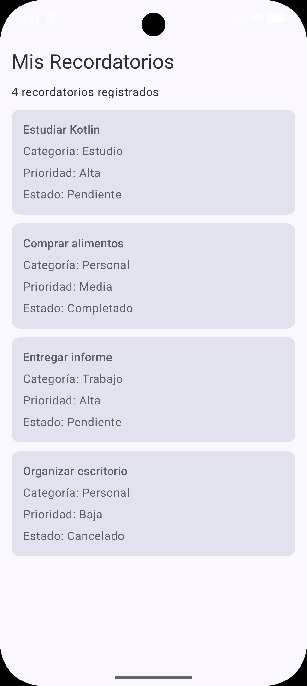

# RecordatoriosApp

> App Android desarrollada con Kotlin y Jetpack Compose — primera iteración de una app de recordatorios contextuales: modelo de dominio inmutable, datos simulados procesados con List, Set y Map, y una pantalla de listado con Material 3.


## Acerca del proyecto

Actividad 1 de **Programación Mobile** — Teclab, Técnica Superior en Programación (Bimestre 2B). La app se desarrolla de forma incremental a lo largo de los cuatro módulos de la materia; esta primera etapa configura el proyecto Android, modela los recordatorios con data classes y sealed classes de Kotlin, y muestra datos simulados en una pantalla inicial construida con Jetpack Compose y Material 3. Todavía no hay formularios, navegación, persistencia ni sincronización remota: llegan en los módulos siguientes.

<p align="center">
  
</p>

## Stack tecnológico

| Capa | Detalle |
|---|---|
| **Lenguaje** | Kotlin 2.2 |
| **UI** | Jetpack Compose + Material 3 (Compose BOM 2026.02.01) |
| **Build** | Gradle (Kotlin DSL) con catálogo de versiones (`gradle/libs.versions.toml`), AGP 9.4 |
| **SDK** | `minSdk` 26 · `targetSdk` / `compileSdk` 37 |
| **JVM target** | Java 11 |

## Modelo de dominio

`Recordatorio` es una `data class` inmutable (todas sus propiedades son `val`). Los datos opcionales se modelan como tipos nullables con valores por defecto, y un bloque `init` rechaza estados inválidos al momento de crear el objeto:

| Propiedad | Tipo | Notas |
|---|---|---|
| `id` | `Int` | Debe ser mayor a 0 |
| `titulo` | `String` | No puede estar en blanco |
| `descripcion` | `String?` | Opcional |
| `categoria` | `Categoria` | Sealed class |
| `prioridad` | `Prioridad` | Sealed class |
| `estado` | `EstadoRecordatorio` | Sealed class |
| `ubicacion` | `String?` | Opcional, por defecto `null` |
| `fechaAviso` | `String?` | Opcional, por defecto `null` |

Los conjuntos cerrados de valores son jerarquías `sealed class` con miembros `data object`, así que todo `when` sobre ellos es exhaustivo sin necesidad de una rama `else`:

| Sealed class | Valores |
|---|---|
| `Categoria` | `Estudio`, `Trabajo`, `Personal` |
| `Prioridad` | `Alta`, `Media`, `Baja` |
| `EstadoRecordatorio` | `Pendiente`, `Completado`, `Cancelado` |

## Datos simulados

`DatosSimulados.kt` contiene los datos de prueba y las operaciones sobre colecciones:

| Valor | Colección | Descripción |
|---|---|---|
| `recordatorios` | `List<Recordatorio>` | Cuatro recordatorios de ejemplo, uno de ellos sin descripción |
| `categoriasUnicas` | `Set<Categoria>` | Categorías en uso, sin repetir (`map` + `toSet`) |
| `coloresCategorias` | `Map<Categoria, String>` | Categoría → etiqueta de color |
| `recordatoriosPendientes` | `List<Recordatorio>` | Filtrados por estado `Pendiente` |
| `recordatoriosAltaPrioridad` | `List<Recordatorio>` | Filtrados por prioridad `Alta` |

## Interfaz

`MainActivity` define el contenido dentro de `RecordatoriosAppTheme` y renderiza `PantallaRecordatorios`: un `Scaffold` con un título, la cantidad total de recordatorios y un `LazyColumn` de `Card`s de Material 3. Cada `TarjetaRecordatorio` muestra el título, la categoría, la prioridad y el estado del recordatorio, convertidos a texto con expresiones `when` exhaustivas.

## Estructura del proyecto

```
RecordatoriosApp/
├── app/
│   ├── build.gradle.kts                    Config del módulo: versiones de SDK, Compose, dependencias
│   └── src/main/
│       ├── AndroidManifest.xml
│       ├── java/com/oviedo/recordatorios/
│       │   ├── MainActivity.kt             Activity + pantalla y tarjeta en Compose
│       │   ├── Recordatorio.kt             Data class y sealed classes
│       │   ├── DatosSimulados.kt           Datos de prueba, Set, Map y filtros
│       │   └── ui/theme/                   Tema Material 3 (Color, Theme, Type)
│       └── res/                            Strings, temas, íconos del launcher
├── gradle/
│   └── libs.versions.toml                  Catálogo de versiones
├── docs/
│   └── screenshot.png
├── build.gradle.kts
└── settings.gradle.kts
```

## Instalación

**Requisitos:** Android Studio (versión estable reciente) con un Android SDK y un emulador creado desde Device Manager, o un dispositivo físico con la depuración USB habilitada.

```bash
git clone https://github.com/aleoviedo071298/recordatorios-app.git
```

1. Abrir la carpeta en Android Studio y esperar a que Gradle sincronice.
2. Elegir un emulador o un dispositivo conectado.
3. Ejecutar la configuración `app`.

## Hoja de ruta

- **Módulo 1** — Configuración del proyecto, modelo de dominio, datos simulados y pantalla inicial en Compose *(esta versión)*.
- **Módulos 2–4** — Formularios y validaciones, navegación, persistencia local, sincronización con la nube, recordatorios por ubicación y programados, versión firmada distribuida mediante un canal de pruebas.

---

**Alejandro Oviedo** · [LinkedIn](https://www.linkedin.com/in/aleoviedo071298/) · [GitHub](https://github.com/aleoviedo071298)
